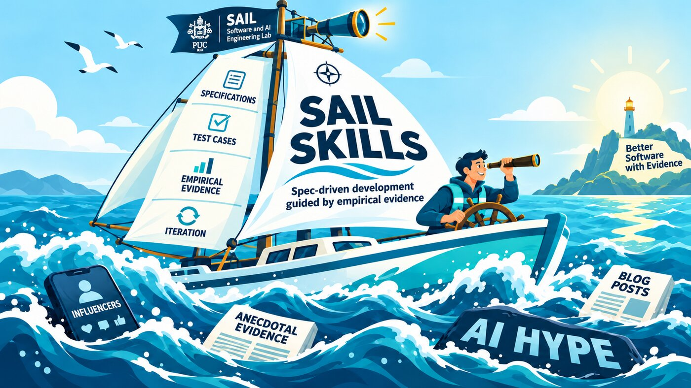

<p align="center">
  
</p>

# SAIL Skills

Agent skills for **spec-driven development guided by empirical evidence**, from the Software and AI Engineering Lab (SAIL) at PUC-Rio.

Coding agents are fast and confident. What they are not, by default, is accountable. These skills make every change pass through a spec you agreed on, scenarios you can execute, a test-first build, and an **evidence pack** that maps each claim to the command that proved it. The agent does the work; the repo keeps the proof.

The skills are plain Markdown. They work with Claude Code, Codex, and any harness that reads `SKILL.md` files. Read them, fork them, change them.

## The flow

Most work travels one route. Each step is a skill you type.

| Step | Skill | What you get |
| --- | --- | --- |
| 1. Sharpen the idea | [`/grill-with-docs`](./skills/engineering/grill-with-docs/SKILL.md) | A relentless interview that also grows the project's glossary (`CONTEXT.md`) and ADRs |
| 2. Write the spec | [`/to-spec`](./skills/engineering/to-spec/SKILL.md) | Typed stories (User, Data, Model, Agent) with **Behavioral Specifications**: Gherkin scenarios tied to the seams they exercise |
| 3. Split the work | [`/to-tickets`](./skills/engineering/to-tickets/SKILL.md) | Tracer-bullet tickets with blocking edges, checked for orthogonality, rendered as a dependency graph |
| 4. Build | [`/implement`](./skills/engineering/implement/SKILL.md) | One ticket, test-first through `tdd`, scenarios kept at hand. [`/implement-sequential`](./skills/engineering/implement-sequential/SKILL.md) and [`/implement-parallel`](./skills/engineering/implement-parallel/SKILL.md) run a whole spec issue |
| 5. Prove it | [`/evidence`](./skills/engineering/evidence/SKILL.md) | A scope-to-proof map published to the issue: claims, verification commands, negative evidence. Runs automatically when `implement` finishes |
| 6. Review | [`/code-review`](./skills/engineering/code-review/SKILL.md) | Two parallel reviews, Standards and Spec, tracing story and scenario IDs back to the spec |

Not sure where you are? [`/ask-sail`](./skills/engineering/ask-sail/SKILL.md) is the router. It names the skill and stops.

Two on-ramps feed the flow: [`/triage`](./skills/engineering/triage/SKILL.md) for issues that arrived from other people, and [`/wayfinder`](./skills/engineering/wayfinder/SKILL.md) for efforts too foggy and too large to hold in one session.

## Install

Two routes, pick one. The plugin is a managed, read-only bundle. skills.sh writes files you own and edit.

<details>
<summary><strong>Claude Code</strong></summary>

```
/plugin install sail-skills --marketplace Esduard/skills
```

On Claude Code older than 2.1.275, add the marketplace first: `/plugin marketplace add Esduard/skills`, then `/plugin install sail-skills@sail`.

</details>

<details>
<summary><strong>Codex, and other agents</strong></summary>

```bash
npx skills@latest add Esduard/skills
```

Pick the skills you want, and which coding agents to install them on. **Make sure `setup-sail-skills` is one of them.**

</details>

Then, once per repo, run [`/setup-sail-skills`](./skills/engineering/setup-sail-skills/SKILL.md). It asks which issue tracker you use (GitHub, GitLab, or local Markdown files), which labels you triage with, and where domain docs live, and records the answers under `docs/agents/`.

## Reference

Skills split on one axis: who can invoke them. **User-invoked** skills run only when you type them; they orchestrate. **Model-invoked** skills can be reached by you or by the agent when a task fits; they hold the reusable discipline.

### Engineering

**User-invoked**

- **[ask-sail](./skills/engineering/ask-sail/SKILL.md)** — Ask which skill or flow fits your situation. A router over the skills in this repo.
- **[setup-sail-skills](./skills/engineering/setup-sail-skills/SKILL.md)** — Configure a repo for the engineering skills: issue tracker, triage labels, domain doc layout. Run once per repo.
- **[grill-with-docs](./skills/engineering/grill-with-docs/SKILL.md)** — A relentless interview to sharpen a plan or design, which also builds the project's domain model: `CONTEXT.md` and ADRs, updated inline.
- **[to-spec](./skills/engineering/to-spec/SKILL.md)** — Turn the current conversation into a spec with typed stories and Behavioral Specifications, and publish it to the issue tracker. No interview, just synthesis.
- **[to-tickets](./skills/engineering/to-tickets/SKILL.md)** — Break a spec or conversation into tracer-bullet tickets with blocking edges and a rendered dependency graph. Text files locally, native blocking links on a real tracker.
- **[implement](./skills/engineering/implement/SKILL.md)** — Build the work described by a spec or ticket, driving `tdd` at agreed seams with the scenarios as reference, then commit and close out with `evidence`.
- **[implement-sequential](./skills/engineering/implement-sequential/SKILL.md)** — Build every subissue of a spec issue one at a time: a fresh subagent per subissue, evidence closed out before the next starts.
- **[implement-parallel](./skills/engineering/implement-parallel/SKILL.md)** — Build every independent subissue of a spec issue in waves: one subagent per subissue in its own worktree, merged back and proven green before the next wave.
- **[triage](./skills/engineering/triage/SKILL.md)** — Move incoming issues and external PRs through a state machine of triage roles and write agent-ready briefs.
- **[wayfinder](./skills/engineering/wayfinder/SKILL.md)** — Plan a huge chunk of work as a shared map of decision tickets on the issue tracker, and resolve them one at a time until the way is clear.

**Model-invoked**

- **[tdd](./skills/engineering/tdd/SKILL.md)** — Test-driven development with a red-green-refactor loop, one vertical slice at a time.
- **[evidence](./skills/engineering/evidence/SKILL.md)** — Publish a factual scope-to-proof map for completed work: claims, verification, negative evidence. `implement`'s mandatory closeout.
- **[code-review](./skills/engineering/code-review/SKILL.md)** — Two-axis review of the diff since a fixed point: Standards and Spec, as parallel subagents so neither pollutes the other.
- **[domain-modeling](./skills/engineering/domain-modeling/SKILL.md)** — Build and sharpen the project's domain model: challenge terms, stress-test with edge cases, update `CONTEXT.md` and ADRs inline.
- **[codebase-design](./skills/engineering/codebase-design/SKILL.md)** — The deep-module vocabulary for designing a module's shape: a lot of behaviour behind a small interface at a clean seam.
- **[prototype](./skills/engineering/prototype/SKILL.md)** — A throwaway prototype that answers one design question, kept as a primary source on its own branch.
- **[research](./skills/engineering/research/SKILL.md)** — Investigate a question against primary sources in a background agent and leave a cited Markdown file in the repo.
- **[resolving-merge-conflicts](./skills/engineering/resolving-merge-conflicts/SKILL.md)** — Work an in-progress merge or rebase conflict hunk by hunk, resolving by intent, never `--abort`.

### Productivity

**User-invoked**

- **[grill-me](./skills/productivity/grill-me/SKILL.md)** — The same relentless interview as `grill-with-docs`, stateless. For plans and designs with no repo under them.
- **[handoff](./skills/productivity/handoff/SKILL.md)** — Compact the current conversation into a handoff document for another agent to pick up.

**Model-invoked**

- **[grilling](./skills/productivity/grilling/SKILL.md)** — The interview primitive behind `grill-me`, `grill-with-docs`, `triage` and `wayfinder`.
- **[writing-for-agents](./skills/productivity/writing-for-agents/SKILL.md)** — Writing documents agents consume: skills, `AGENTS.md`, `CLAUDE.md`, and anything reached by a pointer.

### In progress

Public on purpose, not shipped in the plugin. See [`skills/in-progress/`](./skills/in-progress/README.md).

- **[bdd-scenarios](./skills/in-progress/bdd-scenarios/SKILL.md)** — Gherkin Feature files from agreed behavior, customer-facing or developer-facing, revised through the Oliveira et al. (2019) quality gate. `to-spec`, `implement`, `tdd` and `evidence` already use it.
- **[grafo-dependencias](./skills/in-progress/grafo-dependencias/SKILL.md)** — Dependency graph of a code flow (Mermaid + SVG + component table), edges labeled with the real methods called, no hidden connections. In Portuguese.
- **[perspec-me](./skills/in-progress/perspec-me/SKILL.md)** — Resolve one project question through a PerSpecML concern-guided interview, persisting the answer per Concern.
- **[show-me](./skills/in-progress/show-me/SKILL.md)** — Explain the current topic visually with the smallest view that fits. Vendored from [humanlayer/skills](https://github.com/humanlayer/skills).

### References

Not skills. Material the skills and their users read.

- **[Cloud application architecture patterns](./references/cloud-patterns-catalog/README.md)** — 75 book patterns, each with a short introduction and source-cited aspect pages.
- **[BDD scenario quality](./docs/bdd/oliveira_guidelines.md)** — The quality guidelines `bdd-scenarios` gates on.

## Research context

SAIL studies how software teams work with coding agents. These skills are the instrument: a skills-organized workflow we run in hackathons and industry projects, then evaluate with the participants. The evidence packs, the typed specs and the scenario gate exist because we needed artifacts that can be audited after the fact, not because they are pleasant to write.

## Origins and license

This repository started as a fork of Matt Pocock's skills. The interview primitive (`grilling`), `grill-with-docs`, `domain-modeling`, `tdd`, `wayfinder`, `triage` and a few supporting skills still come from there, in some cases reworked. The spec, ticket, build, evidence and review chain is SAIL's. Everything is MIT licensed; see [LICENSE](./LICENSE).
